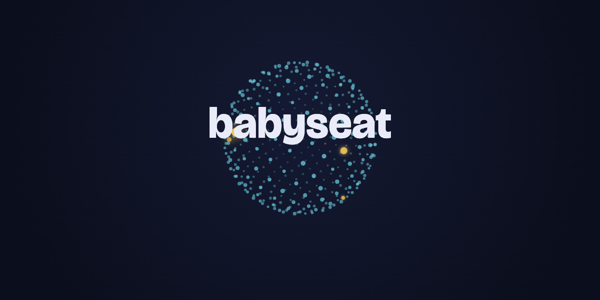

[](https://doi.org/10.5281/zenodo.23550667)


**Talk to it. It remembers.**

babyseat is an AI seat whose memory is a graph the model itself programs. You talk to one chat; the model answers through the
Claude CLI, and everything it knows about you, your files and your work lives as **entities in a field** it reads and writes with
four tools. A banner the model keeps in its own words carries what matters from one turn to the next, so the chat keeps its thread
without replaying history.

The seat is one small native program, `cliffvm` (Rust, one SQLite file, no Python, no Ollama, no database server). Its packs and its page are
files written in **c1f**, the field's own language, so the model can read, change and replay all of it.

> **The names.** **babyseat** is the project (PyPI `babyseat`, Docker `chedim/babyseat`, the Home Assistant integration). **membrane**
> is its memory layer, so the `membrane` command alias, the `membrane/` source folder, the `.membrane` folders and the Home Assistant domain keep that
> name. **cliffvm** is the program. **cliffhanger** is the reactive graph language it runs ([chedim/cliffhanger](https://github.com/chedim/cliffhanger)).

Version **0.7.60**. This is a rebuild: the 0.7 Python seat is retired (see [Upgrading](#upgrading-from-the-python-seat-07x)).

## What you get

- **One chat, in your browser.** The page has Chat (markdown answers, a Stop button, the tools the model ran folded under each answer) and
  Settings (the model, limits, what the seat knows about itself). It is a set of c1f view packs that run in the browser.
- **The model works on the field, not on a prompt.** Four tools only: `entity_query`, `entity_read`, `entity_write` and `run_cliff`
  (a small block of c1f run in one call). Files, commands, HTTP, SQL and Home Assistant are entities the model writes to; the answer is a receipt it reads.
  The model can load its own packs and replace its own banner ([docs/cliffvm.md](docs/cliffvm.md)).
- **Your history comes along.** A seat started over a 0.7 install imports the old chats by itself, newest first.
- **Home Assistant.** A HACS integration makes the seat an Assist conversation agent and lets the model use the house
  ([docs/home-assistant.md](docs/home-assistant.md)).
- **Local and strict.** The door listens on `127.0.0.1`; every route needs a signed token; the page gets one only from this machine ([docs/auth.md](docs/auth.md)).

Not in this release: the 3D field view (built, switched off: `membrane/apps/field.c1f`), the Home Assistant sidebar panel and relay, Ollama and
other local models, Blurp and the quota/self/toybox features of 0.7. They are in the tag `python-seat-last` and the 0.7.53 package.

## Install

You need the `claude` CLI ([Claude Code](https://docs.claude.com/en/docs/claude-code)) on the PATH (or `CLAUDE_BIN=/path/to/claude`) and an Anthropic API key.
macOS and Linux (x86_64 and arm64); there is no Windows build.

| How | Command | State |
|---|---|---|
| pip | `pip install babyseat` then `babyseat` | available at release (wheels: in progress, branch `w118-wheels`) |
| installer | `curl -fsSL https://raw.githubusercontent.com/chedim/membrane/main/install.sh \| bash` | available at release (in progress, `w118-wheels`) |
| Docker | `docker run -p 4096:4096 -v membrane-data:/data -e ANTHROPIC_API_KEY chedim/babyseat` | available at release (in progress, `w118-wheels`) |
| binary | download `babyseat-0.7.60-<target>.tar.gz` from the GitHub release (macOS arm64 and x86_64, Linux glibc and musl, x86_64 and arm64), unpack, run `bin/cliffvm serve` | available at release (in progress, `w118-wheels`) |
| from source | the next section | works today |

`babyseat` and `membrane` are one command: it starts `cliffvm serve` and nothing else. The old subcommands (`opencode`, `store`, `ingest`, ...) are gone.

## Quick start (from source, verified)

```
git clone https://github.com/chedim/membrane && cd membrane
scripts/dist/build.sh --out ./dist/0.7.60          # builds native/ (about a minute warm) and assembles the dist folder
export ANTHROPIC_API_KEY=sk-ant-...                # the claude turn's key (see "Which credential" below)
./dist/0.7.60/bin/cliffvm serve
```

With no `ANTHROPIC_API_KEY` it first warns that the chat will refuse a message until you set one. It prints, in this order:

```
cliffvm serve: claude CLI: /path/to/claude
cliffvm serve: data ~/Library/Application Support/membrane (the door's secret and the admin token are made here)
cliffvm: door listening on 127.0.0.1:4096
cliffvm serve: open http://127.0.0.1:4096/
cliffvm serve: a localhost peer is not the admin: a local tool sends the admin token, written (mode 600, new at every start) to <data>/admin.token
cliffvm serve: curl -H "Authorization: Bearer $(cat <data>/admin.token)" http://127.0.0.1:4096/global/health
```

Open the printed URL: the page loads and you are in the chat. The port is 4096 (`--port <n>` changes it, `--port 0` takes any free port); the data folder is
`membrane` under `$XDG_DATA_HOME`, else `~/Library/Application Support` (macOS) or `~/.local/share` (`--data-dir <dir>` changes it). It holds `seat.sqlite`
(the whole memory), `door.secret` (made at the first start) and `admin.token` (new at every start). Stop the seat with ctrl+c; start it again and the chat is as you left it.

From a checkout you can run the same seat on the repo's own `membrane/` folder: `scripts/seat [--open] [--port <n>]` (data in `./.cliffvm`; the development wrapper).

**Which credential the model uses.** By default the claude CLI answers with the Anthropic API key in the seat's environment (`ANTHROPIC_API_KEY`).
The key is handed to the CLI child and is never written to a property, a row, the journal, a log or a reply. To use the CLI's own login instead, start with
`--fact chat_auth=login` (the dev wrapper: `CLAUDE_AUTH=login scripts/seat`). With neither, the seat says so at start and a message is answered with how to set it.

**Reaching the seat from another machine.** The door opens on `127.0.0.1` only. `--bind 0.0.0.0` opens it to the network (every route still needs a token), and
`--fact host_names=seat.local` lets the page hand out its cookie for a name you reach it by; from another machine the page itself needs a token (the Home Assistant component carries one).

## Connect Home Assistant

1. HACS, three dots, *Custom repositories*, `https://github.com/chedim/membrane`, category *Integration*; install **babyseat (membrane)** and restart Home Assistant.
2. *Settings, Devices & services, Add integration, babyseat (membrane)*: the seat's address (`http://<seat-machine>:4096`; the seat needs `--bind` for that) and the token in `<data>/admin.token`.
3. *Settings, Voice assistants*: pick the **Membrane seat** conversation agent.

The integration is a thin client: it starts no seat and installs no package. It makes a hidden Home Assistant user, *Membrane*, and runs every call the model writes as that
user, so Home Assistant's own permissions decide what the model may touch. Details, the allow-list and the entities: [docs/home-assistant.md](docs/home-assistant.md).

## Upgrading from the Python seat (0.7.x)

Start the new seat once. At its start it looks for the old store (`field.sqlite3` in the places the 0.7 seat used: the new seat's own data folder and its `.membrane` subfolder, `./.membrane`, `~/membrane/.membrane`,
Home Assistant's `/config/membrane/.membrane`), opens it read-only and imports the chat history in the background, newest session first. Nothing else is converted; the old field stays a
read-only source the model can pull from (`Help:legacy`). To name the old store yourself: `cliffvm serve --legacy <path to field.sqlite3, or its folder>`. Details: [docs/migration-design.md](docs/migration-design.md).
Your old data directory is never written. To stay on the Python line: `pip install babyseat==0.7.53` (the source is the tag `python-seat-last`).

## macOS

The seat runs on macOS and Linux alike. On macOS the data folder is `~/Library/Application Support/membrane`. The binary is not signed or notarized: a downloaded copy may be quarantined by Gatekeeper (`xattr -d com.apple.quarantine bin/cliffvm`).

## Documentation

[docs/README.md](docs/README.md) lists every page: what a user reads, what an operator reads, what a developer reads.

## Development

```
cd native && cargo test --release --no-default-features --features bin   # the seat: Rust, real processes, no model
node tests/js/<name>.test.mjs                                            # the page (some need Chrome: CHROME=...)
pytest tests/ha tests/wrapper                                            # the Home Assistant component and the thin Python launcher
```

Layout: `native/` (the VM and the host: Rust), `membrane/packs/` (the seat's packs, c1f), `membrane/apps/` (the barest app: the packs and the page; `field.c1f`, the disabled 3D view),
`membrane/launcher.py` (the whole Python: finds the binary and execs it), `custom_components/membrane/` (Home Assistant), `scripts/` (`seat`, `dist/`), `docs/`.
[AGENTS.md](AGENTS.md) is the checklist for contributors and coding agents.

## Status

A working lab used every day to build itself. Version **0.7.60**; the API and flag surfaces may still move. Licensing: **MIT** (see [LICENSE](LICENSE)); releases up to 0.7.2 stay under PolyForm Noncommercial 1.0.0.

## Cite

If you use babyseat in research, please cite it. The citation metadata is in [CITATION.cff](CITATION.cff) (GitHub's "Cite this repository" reads it), and
every release is archived on Zenodo under the concept DOI [10.5281/zenodo.23550667](https://doi.org/10.5281/zenodo.23550667), which always resolves to the newest version.
