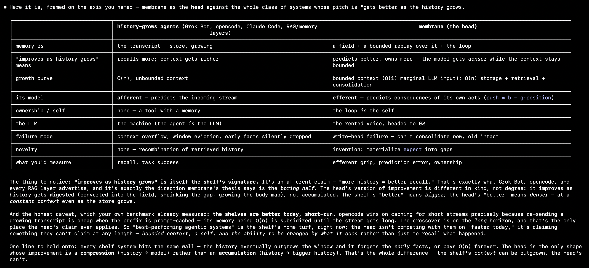

Attention is not enough.
> Complementary Learning Systems (McClelland, McNaughton & O'Reilly, 1995)

# membrane



> A **living entity-field memory for a resident AI seat** — hypervectors with
> a readable geometry, a background mind that works while you're away, every
> write guarded and audited, shared across seats by construction. Local-first;
> it runs in front of [Ollama](https://ollama.com) (or inside
> [Home Assistant](docs/home-assistant.md)).

A Python lab. It runs as a local HTTP server on `127.0.0.1` — technically a
proxy, but that is the mechanism, not the point. The point is the field.

> **Why that name?** The project began as one question — *how do you measure
> "variety" for a memory that decides absorb-a-cached-answer vs
> escalate-to-the-model?* — and the answer is what makes the memory above
> possible and is why it is called **membrane**: a selective, *active* boundary
> between lived memory (the inside) and the incoming world (the outside) that
> absorbs what it has the variety for and escalates the rest. The measured
> underpinnings are in [The math findings](docs/math-findings.md).

---

## What separates membrane from other agentic memory on GitHub

Most memory projects give your agent a store to query.
Membrane is built on different ground rules: a non-von-Neumann architecture running on top of a von-Neumann machine — 
no central fetch-execute CPU; computation is distributed across the field itself and 
driven by a minimal register-correct-predict-act loop that registers new data, compares it against prediction and uses 
surprise as signal that adjusts stored memory and makes a new prediction. 

### 1. The memory has a shape, not just a bag of chunks

The field is not cosine-over-pasted-summaries. It is an entity field over
hypervectors with a geometry you can read and measure: entities with positions
and states, relations between them, tiers of life (nursery → live → dormant),
effective rank, free energy, a conflict fraction. `membrane state` prints the
geometry of a running field; [experiments/variety_toy.py](experiments/variety_toy.py)
shows in one command why a low-variety store reads its outliers as novel and a
high-variety store doesn't (the absorb-vs-escalate decision is measured, not
vibes); [docs/math-findings.md](docs/math-findings.md) carries the experiments.

### 2. It is a seat, not a decorator

You don't bolt it onto an app — the memory **is** the resident process: its own
REST/SSE serve surface, its own chat UI, voice, the Home Assistant integration.
The turn loop runs inside the seat, so every client's turn goes through the
same field path; conversation transcript and memory are the same store, not two
systems reconciling each other (see `membrane serve`, below). While nobody is
talking, a background mind keeps working the field — a thinker digesting event
streams, a dreamer consolidating at night, watchers, entity scripts — and its
minds are visible as live agents at `GET /agent` (counters served fresh from
the running process, nothing cached, nothing faked). The repo dogfoods it: its
own field holds ~14k live entities and learned the codebase while it was
written.

### 3. Structure crystallizes; you curate nothing

No schema to define, no tags to assign, no knowledge graph to hand-build.
Entities are born when experience names them, their states move as the world
speaks, relations and claims accumulate, symbols crystallize through language
([docs/symbol-birth.md](docs/symbol-birth.md)). When two seats assert opposite
things about the same entity, the **divergence is surfaced, never silently
overwritten** — nothing in a teammate's field is destroyed by yours.

### 4. Every write stands trial

A memory that lets the model whisper to itself unsupervised drifts into
self-flattery. Membrane's writes run the same guards a turn runs: dedup,
variety gate, length limits, fenced-code refusal, junk cut — every write
audited with its origin (`agent` / `mcp` / `night` / operator) in
`audit.jsonl`, and every claim traces back to the events that earned it. A
dedicated lane replays earlier gate-verdicts against what the model actually
answered and judges agreement — shadow by default (`--replay-ab P=0`:
recorded, never bypassing you), measured at 0.77 mean similarity on a live
seat ([docs/ab-critic-scorecard.md](docs/ab-critic-scorecard.md) faces the six
criticisms honestly).

### 5. Multi-seat sharing is a property of the data model, not a feature

Every event, state, relation and claim is namespaced by the seat (origin) that
wrote it — writes are disjoint, reads are merged, so one team bucket is
collision-free by construction: a foreign entity's effective state is the seed
plus the mass-weighted mean of every seat's displacement, cross-seat agreement
is promoted into the **commons** at night, and disputed claims get marked
`disputed`, not overwritten. Live peer asks (LAN/VPN, bounded fan-out) let a
seat consult a sibling's field mid-turn. The mechanics:
[docs/multi-dev-field.md](docs/multi-dev-field.md); the team process:
[docs/shared-field-workflow.md](docs/shared-field-workflow.md).

### 6. Local-first, and it degrades honestly

No SaaS, no account, no telemetry, no cloud round-trip required: chat and
embeddings run on your Ollama (cloud models are routable rungs you add with
`membrane auth`); the substrate is your Couchbase bucket — and with no cluster
reachable the seat drops to a RAM field and **still boots** (degradation,
never failure). The whole field is a substrate you own and can move
(`membrane move` / `python -m membrane.reembed`). The memory is for your data: the PolyForm
Noncommercial license covers personal, hobby, research and other noncommercial
use and keeps it out of paid products ([LICENSE](LICENSE)).

### How it maps to the patterns you've already seen

| The common pattern | What membrane does instead |
|---|---|
| Vector store + retriever: paste docs, query chunks | Events with provenance; recall returns nearest **past situations-and-actions** and the named entities' held evidence, not loose chunks |
| Transcript summarizers / rolling history | The full transcript is never replayed: each turn carries a **since-your-last-message diff** of what actually moved |
| Hand-curated knowledge graphs | No hand work: entities, relations, claims crystallize from experience; structure emerges, and every element is auditable back to events |
| In-framework memory (your agent runtime keeps it) | The seat is the runtime — sessions, turns and tool parts live **in** membrane's store; memory and history can't fork |
| Hosted memory APIs (account, endpoint, egress) | Your bucket or your disk; offline mode keeps the seat alive with no cloud at all |

---

## Quick start

Membrane runs three ways: standalone, in Docker, or inside Home Assistant. All
need an [Ollama](https://ollama.com) server with one chat model and one
embedding model (`ollama pull qwen3:8b && ollama pull mxbai-embed-large`, or
any cloud model Ollama serves), and 1–3 GB of RAM for the seat.

### Standalone: its own web UI

```bash
pip install membrane-seat          # or: uv tool install membrane-seat
mkdir ~/bob && cd ~/bob
membrane standalone                # opens http://localhost:4096/ in your browser
```

You get membrane home: the field in 3D, the chat, and voice ("Hey Bob" — a new
membrane is Bob until you agree on a name together; it will ask). Other
devices on your network reach it at `http://<this machine>:4096/`. No login on
the local network; a public or proxied caller is refused — unless you turn on
the optional JWT mode ([docs/auth.md](docs/auth.md)): then every caller needs a
token, from the LAN or behind an ingress alike. Voice needs a secure
origin, so the microphone works on `localhost` (the first voice use downloads
~65 MB of speech models, checked against their checksums).

### Docker

```bash
docker run -d --name membrane \
  -p 4096:4096 -p 11500:11500 \
  -v membrane-data:/data \
  -e MEMBRANE_BACKEND=http://host.docker.internal:11434 \
  -e MEMBRANE_EMBED_MODEL=mxbai-embed-large \
  --stop-timeout 60 \
  chedim/membrane:latest           # then open http://localhost:4096/
```

The same standalone seat in a container: the web UI on :4096 and the
OpenAI-compatible proxy on :11500, the memory on the `membrane-data` volume.
`MEMBRANE_BACKEND` is the Ollama server (the default shown is the Docker
host); on Linux add `--add-host=host.docker.internal:host-gateway`. The
ports have no login unless you set `MEMBRANE_JWT_SECRET` ([JWT mode](docs/auth.md));
without it, publish them only on a network you trust. Details:
[docs/docker.md](docs/docker.md).

### Inside Home Assistant (HACS)

1. HACS → ⋮ → Custom repositories → `https://github.com/chedim/membrane`,
   category *Integration*.
2. Install **Membrane**, restart Home Assistant.
3. Settings → Devices & services → Add integration → **Membrane** →
   *Inside Home Assistant*. If Home Assistant already has the Ollama
   integration, it is used; otherwise give Ollama's address. Pick the models.

Home Assistant then runs the seat as its own child process (started and
stopped with HA, restarted if it dies; its data in `<config>/membrane/`),
opens on membrane home for everyone (HA's sidebar folds away; ☰ leads to HA's
own pages — switch it off in the integration's options), adds the seat as an
Assist conversation agent, and its field's readings as sensors.

**What it can do in your house:** by default the seat may use Home Assistant
through a hidden, non-admin, local-only user ("Membrane") — read any state,
call any service, and mirror the entities it chooses (they update live). It
acts on what people ask, but its commands are written by a model: turn *Let
the seat use Home Assistant* off in the integration's options if you'd rather
it only talks. It can't change Home Assistant's configuration or users.

*Connect to a seat running elsewhere* is for a seat on another machine (the
integration is then only its UI and agent).

### The daily work: typed tools, guarded writes

A seat hands its model the membrane MCP surface — `query`, `state`, `learn`,
`forget`, the entity-hand tools (`entity_add/edit/remove/link/inherit`,
`entity_query`, `entity_tracks`, `entities_related` …), `intend`, `peer_post`,
`graph`. Commands compose in **Cliffhanger**, membrane's command language —
specified and documented in its own repo
([github.com/chedim/cliffhanger](https://github.com/chedim/cliffhanger), with
membrane's instantiation in [docs/cliffhanger.md](docs/cliffhanger.md)). The
model reads the field with `query`/`state`, files an earned
lesson with `learn` (same guards as any turn), cleans its own mistakes with
`forget` — writes are audited with their origin. Meanwhile the ambient layer
needs no command at all: every turn the model sees what the field holds about
the entities it names, and on later turns only the **diff** — which entity
states moved since the last message it processed, whether the change came
from conversation, code, other seats or entity scripts. Two safety lanes run
on every turn and stay advisory: the **gate** replays the nearest past ask
against the live answer (A/B, shadow by default), and the **[membrane]
monologue** in the thinking channel shows the gate verdict, field vitals and
the per-turn memory flow (`/monologue` toggles it).

Idle background loops run on a LOCAL, cheaper model by default
(`--idle-cortex-model`) so a stuck background seat can never burn cloud
tokens. Token economics and routing:
[docs/token-economics.md](docs/token-economics.md).

### Bugs and ideas

[github.com/chedim/membrane/issues](https://github.com/chedim/membrane/issues)
— your membrane knows this too: when it finds a bug in itself it drafts the
issue and hands you the link to file.

---

## Installation

### Install the CLI (one line, no sudo)

```bash
curl -fsSL https://raw.githubusercontent.com/chedim/membrane/main/install.sh | bash
```

Installs the `membrane` CLI globally, user-local (`~/.local/bin`):
`uv tool install` if you have [uv](https://docs.astral.sh/uv/), otherwise a
managed venv at `~/.membrane/venv` + a symlink on your PATH. Re-running it is
safe (upgrade in place). To install from a local checkout instead (e.g. while
hacking on membrane):

```bash
MEMBRANE_REPO=/path/to/membrane bash install.sh
```

**Dependencies, honestly:**

- **Python ≥ 3.10** + **numpy** — the only import-time dep (`couchbase`
  installed by default, imported lazily; a missing cluster degrades that
  feature, never the boot).
- **Ollama** (`brew install ollama` / <https://ollama.com>) — NOT
  auto-installed; embeddings and local chat need it running on `:11434`.
- **opencode** — optional; `membrane opencode` launches it if found on PATH,
  otherwise point any OpenAI-compatible client at `http://127.0.0.1:11500/v1`.
- The **viewer** ships inside the package (three.js + both pixel fonts are
  vendored, served same-origin) — no CDN, no node, no browser install.

### Docker

```bash
docker run -d -p 4096:4096 -p 11500:11500 -v membrane-data:/data \
  -e MEMBRANE_EMBED_MODEL=mxbai-embed-large --stop-timeout 60 \
  chedim/membrane:latest
```

The public image `chedim/membrane` (amd64 + arm64, pushed on every release)
runs `membrane standalone`: the web UI and serve API on :4096, the
OpenAI-compatible proxy on :11500, Ollama reached at
`http://host.docker.internal:11434` by default (on Linux add
`--add-host=host.docker.internal:host-gateway`). The field lives on the
`/data` volume. The ports carry no authentication: publish them only on a
network you trust. Recipes, env and volume details:
[docs/docker.md](docs/docker.md).

### First run in a project

```bash
cd ~/projects/my-app
membrane opencode
```

On first run in a directory it bootstraps that project: auto-installs the
agent skills into `.opencode/skills/` there (project-scoped on purpose), opens
an entity field namespaced by the project's origin, and backfills what it can
without cost (the codegraph; with `membrane backfill`, the project's history).
If no memory sharing is configured it offers (once, interactive shell only) to
connect a Couchbase cluster — decline and it stays a private local field.

It starts the OpenAI-compatible proxy on `:11500` (backend Ollama at
`http://localhost:11434`, override `--backend`/`--model`) and opens the
opencode TUI **attached to membrane's own serve surface**: sessions, turns,
tool parts and their history live in membrane's stores beside the field — the
TUI is a thin client. Every turn is captured into the field (discourse and
observations as events), entities move as the conversation names them, and the
model is grounded by what those entities hold —
[docs/entity-field.md](docs/entity-field.md) is the design doc.

### Surfaces

| Command | What it does |
|---|---|
| `membrane opencode` | the daily driver: proxy on :11500 + membrane's own serve surface (loopback) with the opencode TUI **attached as a thin client** (`MEMBRANE_TUI_DIRECT=1` restores the old direct-provider lane) |
| `membrane serve` | the same seat, headless: membrane's OWN opencode-compatible REST/SSE server (opencode replaced, no child process) |
| `membrane standalone` | the seat with its own web UI — membrane home (the field in 3D), chat, voice; see [docs/standalone.md](docs/standalone.md) |
| `membrane backfill` | rebuild the field from history (code first, then the audit log; idempotent, resumable) |
| `membrane review` | print what the field learned (annotations, replay A/B with `--ab`) |
| `membrane connect` | (re)run shared-field onboarding for THIS project |
| `membrane reset` | kill the seat on :11500 (or `--listen`), relaunch `membrane opencode` fresh |
| `membrane install` | install `.opencode/skills/*` explicitly (+ `.gitignore` entry) |
| `membrane auth` | store a cloud API key in `~/.membrane/auth.json` (600) — its models become routable rungs |
| `membrane move` / `membrane migrate` | migrate the field between stores |
| `python -m membrane.reembed` | move the field to another embedding model (re-embeds every live event, re-applies the log in order) |
| `membrane update` | check the install source, show what changed, apply and re-exec |
| `membrane ingest` | cold start: absorb docs/README into the field (DOC events; a second ingest is a no-op) |
| `membrane codegraph` | stdlib-AST call graph (stats / impact / callers / callees) |
| `membrane doctor` | what's installed/running + the field's vitals |
| `membrane token mint` | `--sub ID [--name NAME] [--ttl 30d]`: a token for a seat running the optional JWT mode (`MEMBRANE_JWT_SECRET`); see [docs/auth.md](docs/auth.md) |
| `membrane stats` | token/call accounting + the savings baseline (`--baseline` compares the bounded window against a naive full-history replay; reads `serve-msgs`, plus the background model calls from `bg-usage.json`; no model call) |
| `membrane bench` | held-out recall benchmark (MRR + hit@k across the `worldline`/`mean`/`state` reads) — runs against a field **copy**, never the live store |

`MEMBRANE_EFIELD` selects the field's mode: `on` (the default: capture,
embed, apply), `shadow` (capture events only — a lab ablation), `off`.

### Headless serving (`membrane serve`)

`membrane serve` runs the seat with **no TUI and no opencode at all** —
sessions, messages, turns, tool parts, aborts, the SSE event stream, served by
membrane itself on :4096 (no login of its own by default: keep it on your network,
put a reverse proxy with its own login in front, or turn on the optional JWT mode —
a token on every request to both ports, [docs/auth.md](docs/auth.md)). Any opencode client connects unchanged: the
[mobile companion app](https://opencode.app/), IDE plugins, a script. The turn
loop calls the seat's OWN `/v1` on loopback — gate, injection, capture and
routing run through the exact code path every other client's turn uses, so
the serve surface adds no separate memory, and the model's tool invocations
appear to the client as ordinary tool parts riding `message.part.updated`
(pending → completed), so you can watch what it's doing from the room.
`--serve-port` (default 4096, walks up if busy) and `--listen` (the proxy,
default 11500) are independent. The proxy binds all interfaces by default and
its write/exec routes carry no auth; `--listen-host 127.0.0.1` (or
`MEMBRANE_LISTEN_HOST=127.0.0.1`) keeps it on this machine. Exposure is LAN-only by design:
reach the server only from a network you own — or set `MEMBRANE_JWT_SECRET`
and hand each client a token ([docs/auth.md](docs/auth.md)).

- **The minds are visible.** `/agents` lists the ambient minds as agents —
  the three thinking-loop workers (each with its live claim and the event
  queue's depth) plus `thinker` and `dreamer` with their real counters.
- **The loop queue is RAM-only and dies with the seat** — a seat restart
  drops pending reactive work on purpose; stale reactions must not outlive
  their justification. What must survive a restart belongs in the field
  (`learn`), not in the queue.

---

## Sharing a team field (Couchbase)

Point every seat at the same Couchbase bucket: one bucket per **team**, the
`membrane` scope, the nine entity-field collections (`events`, `sentences`,
`terms`, `entity_states`, `entity_deltas`, `relations`, `claims`,
`annotations`, `origin_stats`), created and indexed on first boot. Projects
distinguish themselves by the **origin** axis — a seat writes ONLY rows keyed
by its own origin; do NOT add per-project buckets (that would defeat
cross-seat agreement).

```bash
membrane connect        # conn string, user, password (hidden), bucket
```

The same offer appears automatically on the first run in a project with no
store configured (interactive shell only; declining is remembered). **Secrets
never touch the repo** — credentials are stored per-project OUTSIDE it, at
`~/.membrane/projects/<slug>.env` (mode 600), and a `.env` inside the repo is
designed-out of the failure mode. Plain env config still works:

    export MEMBRANE_STORE=couchbase
    export COUCHBASE_CONN_STRING=couchbase://<team-host>
    export COUCHBASE_USER=... COUCHBASE_PASSWORD=... COUCHBASE_BUCKET=membrane

A local cluster answering at the default endpoint is auto-detected at boot;
an unreachable cluster transparently falls back to the RAM field. What
sharing guarantees — disjoint writes / merged reads, divergence surfaced, the
commons, live peer asks — is in
[docs/multi-dev-field.md](docs/multi-dev-field.md), and the full team process
in [docs/shared-field-workflow.md](docs/shared-field-workflow.md).

---

## Measured, not promised

Token and recall numbers from the operator's own live seat (1,215 sessions,
1,955 user messages, 3,840 assistant turns, through 2026-10-15) — real
traffic, not a synthetic benchmark. Reproduce with
`membrane stats --store .membrane/serve-msgs.json --baseline` (read-only, no
model call); the recall numbers reproduce with `membrane bench --field
<field-copy>` (held-out, MRR + hit@k) or the scripts in `experiments/`.

| metric | value |
|---|---|
| input / output / reasoning tokens | 36.1M / 5.5M / 8.5M |
| cache-read | 14.2M — **39.5% of input** (prompt caching) |
| tokens per turn (input+output) | 10.8K avg · **1.55K median** · 137K p99 |
| LLM calls per turn (tool-loop rounds) | ~4.9 |
| recall injection size | **~700 tokens median** · ~1.1K p99 (never the transcript) |

**Savings vs a naive full-context runner** (the default for an agent runner:
replay the whole transcript every turn, growing O(n²)):

| replay strategy | context tokens | vs full-context |
|---|---|---|
| full-context replay | 74.3M | — |
| membrane's bounded window (12 msgs × 4K chars) | 1.9M | **−97%** |
| membrane actual (window + recall + tool loop) | 36.1M | **−51% net** |

The window's saving lands almost entirely on long conversations: turns with
200+ prior messages contribute 68.5M of the 72.4M tokens saved; under the
12-message window it is neutral (recall + tool loop is the standing cost).
The naive side uses the seat's own ~4 chars/token estimate, so the −51% is
conservative.

**Recall quality** (held-out, over the same seat's history): entity worldlines
lift "who 1,500 never-seen mentions were about" from MRR **0.210 → 0.539**
(mature entities 0.206 → 0.634); see the v0.5.0 notes and `experiments/`.

- **Token economics, live seat (2026-10-12):** 5,736 live entities over
  4,949 streamed events; the standing per-turn header ~3 KB (entity tracks,
  one line each) instead of state dumps; per-turn injection is the state
  **diff**, not the transcript; a recall of a few hundred tokens replaces
  re-reading a 4,000-line log. [docs/token-economics.md](docs/token-economics.md)
- **The gate is calibrated by experiment:** cosine-primary similarity with a
  novelty specialist as the escalation judge; the variety toy reproduces the
  decision in one command. [docs/math-findings.md](docs/math-findings.md),
  [docs/ab-critic-scorecard.md](docs/ab-critic-scorecard.md) (replay A/B
  agreement 0.77 on a live seat, six criticisms faced)
- **The field's own state is readable:** `membrane state` / `membrane doctor`
  print live events by stream, entities by tier, geometry (effective rank,
  free energy, conflict fraction), the replay ledger, the last night pass.

## Lifecycle

- **Update check at boot** (opt out `MEMBRANE_NO_UPDATE_CHECK=1`): the CLI
  compares against its install source (git or PyPI), prints the CHANGELOG
  delta, and asks before pulling (`--ff-only`; a dirty tree is refused).
  Inside Home Assistant, updates come through HACS.
- **Restart only from the shell** (`membrane reset` / `./run.sh restart`).
  Membrane never restarts itself while running, and a restart loses nothing:
  the field re-hydrates from its backend. The one way a restart CAN change
  results is a re-embed (`python -m membrane.reembed`, moving to another
  embedding model).
- **Field moves are first-class**: `membrane move` between stores,
  `membrane migrate` as the interactive front door, `python -m
  membrane.reembed --embed-model M` pins the rebuilt field equal to a fresh one.

---

## Documentation map

| Doc | What's in it |
|---|---|
| [docs/standalone.md](docs/standalone.md) | **Standalone mode**: the web UI, the first run and the name, who can reach it, voice, `settings.json`, updates |
| [docs/docker.md](docs/docker.md) | **membrane in Docker**: the public image `chedim/membrane`, run recipes (Docker Desktop, Linux, Compose), env, the `/data` volume, ports, stopping |
| [docs/auth.md](docs/auth.md) | **JWT mode (optional, off by default).** Turning it on, minting tokens, giving a client its token, the cookie login, who-said-it from the token, the seat's internal token, rotation, the threat model |
| [docs/home-assistant.md](docs/home-assistant.md) | **Membrane in Home Assistant** (HACS): setup, the UI takeover, the Assist agent and sensors, what the seat may do in the house |
| [docs/entity-field.md](docs/entity-field.md) | **THE FIELD.** Events → entities → readers; the update rule; relations and claims; injection (full block / state diff); the gate + replay A/B; storage, sharing, the background mind; the operator/listener/plan tool lanes + the intent lane |
| [docs/cliffhanger.md](docs/cliffhanger.md) | **The command language.** Entities as objects, ISA parents as classes, methods and calls, `{{self.*}}`/`{{name}}` binding — and the pointer to its own spec repo |
| [docs/seat-first-2-tier.md](docs/seat-first-2-tier.md) | The seat-first two-tier field: local authoritative store, a published global tier on your terms |
| [docs/shared-field-workflow.md](docs/shared-field-workflow.md) | **Team field: the process.** Day-one setup, the async loop, watches, operator rules, go-live checklist |
| [docs/multi-dev-field.md](docs/multi-dev-field.md) | **Team field: the substrate.** The origin axis, disjoint writers / merged reads, divergence conflicts, the commons |
| [docs/global-field.md](docs/global-field.md) | The global commons: facts true beyond one repo; operator promotion, consensus, residency |
| [docs/background-mind.md](docs/background-mind.md) | **The background mind:** thinker + dreamer, the NightClock, entity scripts and tracks, the intent steering wheel, **the pause**, kill switches |
| [docs/selfgrowth.md](docs/selfgrowth.md) | **Growing self (#161).** Waking it with the 🌱 growth limit, reading its bar and the amoeba, the ladder's rungs and their real pass tests, how to help it climb, troubleshooting |
| [docs/vsa-token-lane.md](docs/vsa-token-lane.md) | **Entity keys + relations (the VSA lane).** Canonical ids, key binding, the relations composites, structure-awareness numbers |
| [docs/token-economics.md](docs/token-economics.md) | Where the savings come from + the router: the ladder, the ceiling, the outage fallback |
| [docs/monologue.md](docs/monologue.md) | The `[membrane]` thinking-channel banner: every line explained, `/monologue` toggle |
| [docs/symbol-birth.md](docs/symbol-birth.md) | The symbol crystallization: how the hierarchy is born through language |
| [docs/math-findings.md](docs/math-findings.md) | The measured math: the variety/gate experiments and the e-series evidence |
| [docs/ab-critic-scorecard.md](docs/ab-critic-scorecard.md) | The A/B scorecard vs a plain cosine cache — six criticisms faced honestly |
| [docs/fork-port-notes.md](docs/fork-port-notes.md) | Fork notes (what it took to port membrane's ideas into another project) |

---

## Development

Source layout: `membrane/` (the field: `streams` → `efield`/`efstore` →
`entity_block`/`efgate`/`night`; the seat's serve server (`server.py`,
opencode-compatible); the MCP surface (`mcp_server.py`); the CLI),
`experiments/` (the e-series rigs behind math-findings), `tests/` (unittest +
pytest, plain-python runnable), `Dockerfile` + `docker/` (the public image;
`docker build -t membrane:dev .`, see [docs/docker.md](docs/docker.md)).

```bash
python -m unittest discover -s tests     # everything runs against in-process fakes, no server needed
python experiments/variety_toy.py        # the variety toy: the gate's calibration in one command
```

---

## Status

Working lab, in daily use on its own development (dogfooded: this repo's own
field holds ~14k live entities and its background mind digests, dreams, and
speaks about its own work). Version **0.6.2**; API and flag surfaces may still
move. Licensing: **PolyForm Noncommercial 1.0.0** (see [LICENSE](LICENSE)) —
free to use, modify and share for any noncommercial purpose (personal, hobby,
research, education, charities and public institutions); commercial use needs
the author's written permission — ask.
