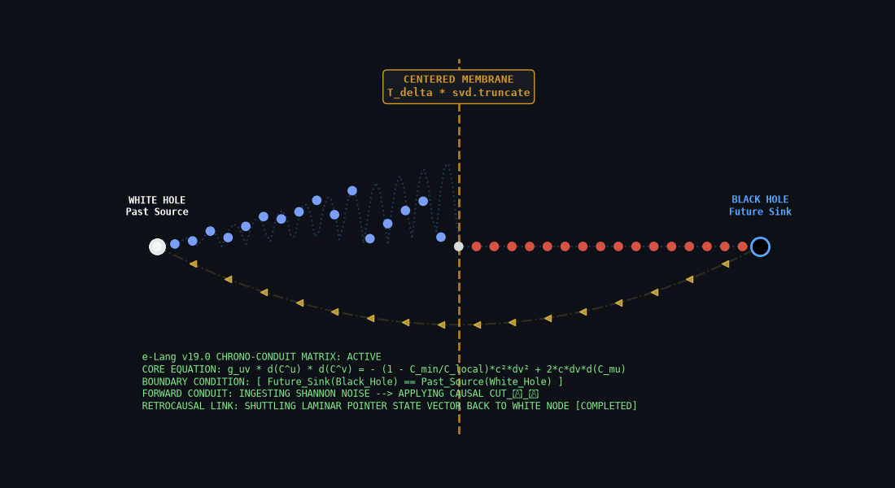

# membrane



> A **text-based hypervector Ollama proxy hippocampus for opencode** that
> learns as you go, shares a Couchbase-backed team memory, and **orchestrates
> LLM calls** between local and cloud inference.

A **Python lab**. It runs as a local HTTP server on
`127.0.0.1` in front of Ollama (or Anthropic) — technically a proxy, but that
is the mechanism, not the point. The point is the field.

> **Why that name?** The project began as one question — *how do you measure
> "variety" for a memory that decides absorb-a-cached-answer vs
> escalate-to-the-model?* — and the answer is what makes the memory above
> possible and is why it is called **membrane**: a selective, *active* boundary
> between lived memory (the inside) and the incoming world (the outside) that
> absorbs what it has the variety for and escalates the rest. The full story
> lives in [The thermodynamic principle](docs/principle.md) and
> [The math findings](docs/math-findings.md).

This README is the **developer workflow** — install, launch, connect a team
field, and the daily loop. What the field does under the hood, how sharing
works, and the project's history are in the sub-documents (see
[Documentation map](#documentation-map)).

---

## Table of contents

- [Installation](#installation)
  - [Install the CLI](#install-the-cli-one-line-no-sudo)
  - [First run in a project](#first-run-in-a-project)
  - [Daily workflow](#daily-workflow)
  - [Other surfaces](#other-surfaces)
  - [Claude Code (Anthropic cloud)](#claude-code-anthropic-cloud)
- [Sharing a team field (Couchbase)](#sharing-a-team-field-couchbase)
  - [`membrane connect` (recommended)](#membrane-connect-recommended)
  - [Manual setup via env](#manual-setup-via-env)
  - [What sharing guarantees](#what-sharing-guarantees)
- [Checking on the field](#checking-on-the-field)
- [Documentation map](#documentation-map)
- [Development](#development)
  - [Run the tests](#run-the-tests)
  - [Run the toy](#run-the-toy)
- [Status](#status)

---

## Installation

### Install the CLI (one line, no sudo)

```bash
curl -fsSL https://raw.githubusercontent.com/chedim/membrane/main/install.sh | bash
```

Installs the `membrane` CLI globally, user-local (`~/.local/bin`):
`uv tool install` if you have [uv](https://docs.astral.sh/uv/), otherwise a
managed venv at `~/.membrane/venv` + a symlink on your PATH. Re-running it is
safe (upgrade in place). To install from a local checkout instead (e.g. while
hacking on membrane):

```bash
MEMBRANE_REPO=/path/to/membrane bash install.sh
```

Requires Python ≥ 3.10 (numpy is the only import-time dep); embeddings/chat come from a running
[Ollama](https://ollama.com). Without installing anything, one-off via uvx:
`uvx --from "membrane @ git+ssh://git@github.com/chedim/membrane" membrane install`.

**Dependencies, honestly:**

- **Python ≥ 3.10** + **numpy** — the only import-time dep. `couchbase` (the shared
  field) and `paho-mqtt` (the event bus) are installed by default (`pip install -r
  requirements.txt` / the pyproject) but imported lazily; either one missing degrades
  that feature, never the boot.
- **Ollama** (`brew install ollama` / <https://ollama.com>) — NOT auto-installed; embeddings
  and local chat need it running on `:11434`. Optional: a **Couchbase** cluster for shared
  team fields (the `couchbase` pip package is imported only when you actually connect,
  and its absence falls back to the local JSON field).
- **[opencode](https://opencode.ai)** — NOT auto-installed either; `membrane opencode`
  launches it if found on PATH (`sh <(curl ... opencode.ai/install.sh)`), otherwise the
  proxy runs bare and you point any OpenAI-compatible client at `http://127.0.0.1:11500/v1`
  (`--no-launch` skips the spawn entirely). The other surfaces (viewer, review,
  ingest, codegraph) need nothing beyond Python.
- The **viewer** ships inside the package (three.js + both pixel fonts are vendored,
  served same-origin at `/viewer`, opened in your browser on start; `--no-viewer --no-open`
  to disable) — no CDN, no node, no browser install.

### First run in a project

```bash
cd ~/projects/my-app
membrane opencode
```

That's the whole workflow. On first run in a directory it bootstraps that
project:

- auto-installs the eight agent skills (query / learn / forget / state /
  global-field / codegraph / ingest / restart)
  into `.opencode/skills/` there (project-scoped on purpose — an opencode
  launched elsewhere never sees them; skip with `MEMBRANE_NO_AUTOINSTALL=1`),
- creates the per-project memory data in `.membrane/` there (`field.json`,
  `audit.jsonl`, logs; `membrane install` appends `.membrane/` to
  `.gitignore`),
- if no memory sharing is configured, offers (once, interactive shell only)
  to connect a Couchbase cluster for this project — decline and it stays a
  private local field (see
  [Sharing a team field](#sharing-a-team-field-couchbase)).

It then starts the OpenAI-compatible proxy on `:11500` (backend Ollama at
`http://localhost:11434`, override `--backend`/`--model`) and opens opencode
pointed at it. Every turn is grounded by the field's recall and learned back —
that project accumulates its own long-term memory in `.membrane/`.

### Daily workflow

Inside opencode, the field answers five canonical frames itself —
**intercepts: no model call, never learned**:

    membrane: query the field for <topic>     read recall
    membrane: learn that <fact>               write a memory
    membrane: forget <what or which>          delete (indexes "3-7, 9",
                                              topics, "the last hour",
                                              "this session", "everything")
    field state                               memory health/stats
    membrane: suggest                         review scope suggestions for
                                              the cross-project commons

The agent may also emit these frames in its own prose; answers arrive next
turn as clearly-marked `[membrane-intercept]` blocks. Writes from model prose
execute by default (`--no-agent-writes` reverts to report-only): a learn runs
the same guards as any turn and is audited `origin: agent` (tagged
`agent-note`); forgets only in explicit index form (capped, wordy asks merely
propose). The thermodynamics is the collapse guard — the model cannot skip
dedup, the vague filter, or the variety gate.

Everything else is ambient: recall grounds each turn (now entity-boosted:
cells are tagged with files/symbols/models/tool names at capture time, and a
query naming one pulls its cells in even when cosine alone would miss),
membrane never answers the user from memory by default (`--replay-sim 0` =
pure observer; set >0 to re-enable the replay saver), and the router picks
the cheapest eligible model — free-tier-only by default (`--cloud-budget 0`;
paid rungs need an explicit budget). Idle background loops (compaction,
entity synthesis) distill on a LOCAL cortex by default (`--idle-cortex-model`,
default = the first local Ollama chat model by family preference — granite,
glm, qwen3, qwen2.5-coder, … — `granite3.3:8b` only when the tag list is
unreadable) so a stuck background seat can never burn cloud tokens. The `[membrane]` monologue in your thinking channel shows the gate
verdict, field vitals, and the per-turn memory flow (gave/learned); toggle it
with `/monologue`. How the token economics and routing work:
[docs/token-economics.md](docs/token-economics.md).

### Other surfaces

| Command | What it does |
|---|---|
| `membrane opencode` | field-backed opencode on :11500 (the daily driver) |
| `membrane review` | print what the field learned |
| `membrane connect` | (re)run shared-field onboarding for THIS project |
| `membrane reset` | kill the seat on :11500 (or `--listen`), relaunch `membrane opencode` fresh |
| `membrane install` | install `.opencode/skills/*` explicitly (+ `.gitignore` entry); prints the AGENTS.md blurb |
| `membrane auth` | store a cloud API key (anthropic, openrouter, gemini, groq, github, mistral) in `~/.membrane/auth.json` (600) — its models become routable rungs + picker entries |
| `membrane move` | migrate the field between stores (cb↔cb, cb→json, json→cb) |
| `membrane migrate` | interactive migration front door: detects where the field lives, asks for the target, runs `move` |
| `membrane update` | check the install source, show what changed, apply (`git pull --ff-only`) and re-exec |
| `membrane ingest` | cold start: absorb docs/README into the field (no model call) |
| `membrane codegraph` | stdlib-AST call graph (stats / impact / callers / callees) |
| `membrane doctor` | what's installed/running (CLI, skills, Ollama) |
| `membrane tui` / `proxy` / `anthropic` / `demo` | RETIRED — print a pointer to `membrane opencode` |

`./run.sh` still works in-repo and delegates to the same CLI (bare = opencode;
`./run.sh restart` = `membrane reset`).

### Claude Code (Anthropic cloud) — RETIRED

The old `./run.sh anthropic` / `--anthropic` observer mode (a proxy on
`:11435` in front of Claude Code) was cut with the proxy — `membrane
anthropic` now only prints the retirement pointer. The opencode seat is the
surface; to route Anthropic models through it, `membrane auth` stores the
key (`~/.membrane/auth.json`, mode 600) and its models become rungs on the
router's ladder.

---

## Sharing a team field (Couchbase)

By default the field is a private local JSON file. To make a team share one
substrate — same project, different machines, one memory — point every seat at
the same Couchbase cluster. One bucket per **team**, `membrane` scope,
`exemplars` collection; projects distinguish themselves by the origin axis (do
NOT add per-project buckets — that would defeat independent-agreement
promotion).

### `membrane connect` (recommended)

Run in the project directory; answer four prompts:

```bash
membrane connect
#   conn string   [couchbase://127.0.0.1]
#   user          [Administrator]
#   password      (hidden)
#   bucket        [membrane]
```

The same offer appears automatically on the first `membrane opencode` /
`membrane reset` in a project that has no store configured (interactive shell
only; declining is remembered — it becomes a private field, and `membrane
connect` re-opens the question).

**Secrets never touch the repo.** Credentials are stored per-project OUTSIDE
it, at `~/.membrane/projects/<slug>.env` (mode 600, slug = project path +
hash), and are exported into the environment at every launch from that
directory. A `.env` inside the repo would leak on the first `git add .` —
that failure mode is designed out.

Kill switch: `MEMBRANE_NO_ASK=1` silences the launch-time prompt (an explicit
`membrane connect` still works, as does plain env config).

### Manual setup via env

The classic path still works (cortex-experiment's env convention):

    export MEMBRANE_STORE=couchbase
    export COUCHBASE_CONN_STRING=couchbase://<team-host>
    export COUCHBASE_USER=... COUCHBASE_PASSWORD=... COUCHBASE_BUCKET=membrane

A **local** cluster answering at the default endpoint is auto-detected at
boot — no config needed on a dev box that already runs one. Unreachable
cluster → transparent fallback to the JSON field (degradation, never failure).

### What sharing guarantees

Mechanics that make sharing collision-free (all pinned by
`tests/test_shared_substrate.py`; details in
[docs/multi-dev-field.md](docs/multi-dev-field.md)):

- every memory key is **namespaced by origin** (the field-id where it was
  born); deletes only ever touch own keys; foreign patches are read-only;
- two membranes earning **different answers for the same situation** → CAS
  arbitration: the more salient version masters the situation, the loser
  **defers** into `alternates` — CAN-style, nothing is destroyed;
- foreign memories near-identical to one you hold **poke through** the veil
  (cosine ≥ 0.90) as marked context at boot;
- teammates online get **live peer asks** on escalations (bounded fan-out,
  LAN/VPN); `peers: N live` at boot.

The full team process — day-one setup checklist, the async work loop across
time zones, the watch layer, operator rules — is
**[docs/shared-field-workflow.md](docs/shared-field-workflow.md)**.

---

## Checking on the field

- `field state` (in opencode) — backend, field composition, thermodynamics
  (`effective_rank`, `free_energy`), gate knobs, compactor counters.
- `membrane review` — what the field learned, distilled notes included.
- `.membrane/audit.jsonl` — the full per-turn audit trail (routings, judges,
  operator hands).

What the numbers mean and how the field's "thermodynamics" work:
[docs/principle.md](docs/principle.md) (plain words) and
[docs/math-findings.md](docs/math-findings.md) (the measured math).

## Lifecycle: updates, restarts, schema compatibility

- **Update check at boot.** On `membrane opencode` / `membrane reset`, membrane
  checks its install source (the git checkout it runs from, or the pip/uv
  direct URL it was installed from). If an update exists it prints the
  CHANGELOG (the commits between you and the remote tip) and asks
  `Update membrane now? [y/N]` in the terminal — answering yes pulls
  (`--ff-only`, a dirty tree is refused) and re-execs with the same argv.
  Non-interactive sessions are never interrupted; `membrane update` runs
  the same path manually. Opt out with `MEMBRANE_NO_UPDATE_CHECK=1`.
- **Restart only from the shell.** `./run.sh restart` (= `membrane
  reset`: kills the seat listening on :11500 — or `--listen` — and
  relaunches `membrane opencode`) is the safe procedure — see the
  membrane-restart skill. Membrane
  never restarts itself while running (no file watcher, no self-re-exec);
  a restart loses nothing: the field re-hydrates from its backend.
- **The schema sliding window.** The field's record schema carries a
  version (`SCHEMA_VERSION`; Couchbase docs are stamped `_scm`). One
  version reads one older (migrations chain in a registry) and PRESERVES
  unknown keys from newer writers — so membranes of adjacent versions
  share a bucket (or swap a JSON field) without erasing each other's
  fields, and upgrades never require a flag day. Bump `SCHEMA_VERSION`
  only together with a registered migration in `membrane/field.py`.

## Easter egg: a self-authoring virtual world

The same field, worn as a world: point the proxy at a fictional premise and
it grew a **self-authoring world on its own clock**; you inhabited it as a
voiced protagonist. **RETIRED** — the toy world and its proxy/TUI surfaces
were cut (`070af25` / `b01b111`: membrane is the opencode seat only). The
player's manual **[docs/exploration-game.md](docs/exploration-game.md)** is
kept as history; its launch commands no longer run.

---

## Documentation map

| Doc | What's in it |
|---|---|
| [docs/shared-field-workflow.md](docs/shared-field-workflow.md) | **Team field: the process.** Day-one setup, the async loop, watches, operator rules, go-live checklist |
| [docs/multi-dev-field.md](docs/multi-dev-field.md) | **Team field: the substrate.** Origin axis, veil, arbitration — what makes multi-seat sharing collision-free |
| [docs/background-mind.md](docs/background-mind.md) | **The background mind: thinker + dreamer + the timeline organ.** Three clocks (turns / thinker hum / dreamer waves), timeline entities under session:now with reality's vote, the curiosity loop, model-authored entity scripts, ANN recall + the personalized field, metric-targeted auto-compact, kill switches |
| [docs/vsa-token-lane.md](docs/vsa-token-lane.md) | **The VSA token lane (the rosetta transposition).** Every token a transition: the embedder-seeded hypervector codebook, the order-sensitive recurrence, the dual-lane recall + advisory surprise, the seven consumers (shape recall, loop fingerprint, shape-aware dedup, the order-shaped dream ballot, thinker convergence, the shape-poke, the streaming prefix seam), the kill switches |
| [docs/dev-organism.md](docs/dev-organism.md) | The dev organism (RETIRED — `cell.py` / `pool.py` deleted in `070af25`; history only): cells that grazed the field — curiosity veils, the bud/death economy |
| [docs/global-field.md](docs/global-field.md) | The global commons: facts true beyond one repo; operator promotion, consensus, residency drift |
| [docs/token-economics.md](docs/token-economics.md) | Where the savings come from (intercepts, replay, compaction) + the router: the ladder, the ceiling, the outage fallback, the free-tier default budget |
| [docs/monologue.md](docs/monologue.md) | The `[membrane]` thinking-channel banner: every line explained, the memory flow (gave/learned), `/monologue` toggle |
| [docs/fork-port-notes.md](docs/fork-port-notes.md) | Porting checklist for the ollama-membrane fork: observer default, free-tier budget, entity tracks v2 (boundary state machine + the mixed banner) + the enrichment ladder, WHERE WE ARE, boot-speed KV hydrate |
| [docs/principle.md](docs/principle.md) | "Only variety absorbs variety" — Ashby's law with the telos flipped; free_energy, effective_rank, the veil, multi-membrane |
| [docs/math-findings.md](docs/math-findings.md) | The substrate-phase math: three experiments, one self-correcting conclusion (cosine primary, novelty specialist) |
| [docs/ab-critic-scorecard.md](docs/ab-critic-scorecard.md) | The A/B scorecard vs a plain cosine cache — six criticisms faced honestly |
| [docs/exploration-game.md](docs/exploration-game.md) | The easter egg (RETIRED — history only): membrane as a self-authoring exploration game (player's manual) |
| [docs/close-the-gap.md](docs/close-the-gap.md) | Closing the TencentDB-Agent-Memory gap: warehouse vs dynamical system, the two gaps closed (cold-start ingest, CodeGraph-lite), what stays deliberately un-adopted (ACL panel, versioned assets) |
| [docs/symbol-birth.md](docs/symbol-birth.md) | The symbol crystallization: how the hierarchy is born — symbols come into being through language; the thesis, its structural membrane mapping, the consequence to keep |
| [docs/post-restart-plan.md](docs/post-restart-plan.md) | Working notes: routing-fix verification and the roadmap |
| *the cycled / endless environment* (sibling `cortex-experiment` repo) | The theory notes behind the principle (the loop, and the trap unbounded variety sets) |

---

## Development

Source layout: `membrane/` (field, router, opencode host + seat proxy),
`experiments/` (variety toys, multi-membrane rigs), `tests/` (unittest,
plain-python runnable), `worlds/` (saved easter-egg worlds).

### Run the tests

```bash
python -m unittest discover -s tests     # or: .venv/bin/python -m unittest discover -s tests
```

No server needed: the couchbase-substrate and router tests run against fakes
in-process.

### Run the toy

The original variety experiment (what makes a store confident vs unsure —
the gate's calibration in one command):

```bash
pip install -r requirements.txt   # numpy only
python experiments/variety_toy.py
```

Expected: the low-variety store has low effective-rank and low spread; a query
off its manifold reads as highly novel (gate escalates), while the same query
against the high-variety store reads as in-manifold (gate acts).

---

## Status

Working lab, in daily use on its own development (dogfooded: this repo's own
field learned the codebase while it was being written — and its background
mind now digests, dreams, elects, and speaks about its own work). Not yet
version-released; API and flag surfaces may move. **Private project** — no
license yet; all rights reserved by the author.
